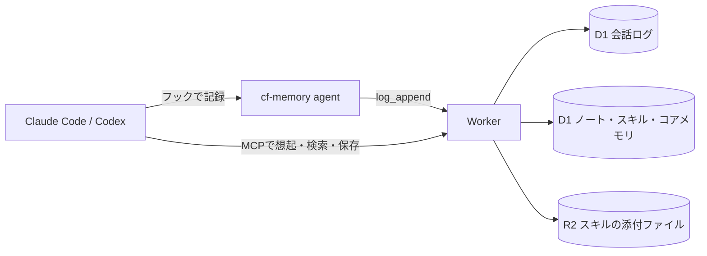

# cf-memory

[](https://github.com/24taro/cf-memory/actions/workflows/ci.yml) · [MIT License](LICENSE)

**Claude Code と Codex の記憶を、自分の Cloudflare アカウントに。**
新しいセッションで昨日の判断を引き継ぎ、根拠となった会話を検索し、残したい知識をノートにできます。

[導入](#導入) · [仕組み](#仕組み) · [データの置き場所](#データの置き場所) · [English](README.md)

| やりたいこと | cf-memory の動き |
| --- | --- |
| 同じリポジトリで作業を再開する | コアメモリと前回のセッションの最終回答を渡します。 |
| 過去の判断と理由を調べる | 関連ノートを想起し、エージェントは保存済みの会話もキーワードで検索できます。 |
| Claude Code と Codex を切り替える | 同じインスタンスに接続すれば、両方からノートと会話履歴を参照できます。 |

Worker 1つ、D1 データベース2つ、R2 バケット1つで動きます。検索には SQLite FTS5 を使用し、日本語と英語に対応します。埋め込みやモデルの呼び出しは発生しません。MIT ライセンスの独立プロジェクトです。

初回リリースのサポート対象は、固定 API トークンを使う単一オーナー構成です。[チームモード](docs/TEAM-MODE.md) は実験的な機能です。

## 導入

**必要なもの。** R2 を有効にした Workers Paid プラン、Git、Bash、Node.js 22.12 以降の 22.x または 24 以上と npm、OpenSSL、curl。クライアントは Claude Code 2.1.327 以降か Codex を用意します。Claude Code が旧版の場合は先に更新してください。

```bash
git clone https://github.com/24taro/cf-memory.git
cd cf-memory
./install.sh
```

Cloudflare のログインを求められたら承認してください。インストーラーがストレージを作成し、Worker をデプロイして API トークンを保存し、見つかったクライアントを接続します。Worker だけを導入する場合は `./install.sh --no-client` を使います。

- **Claude Code**は導入後に再起動します。
- **Codex**は、表示された `export` 2 行をシェルで反映してから起動し、`/hooks` で cf-memory のフック4件を承認します。

### 引き継ぎを試す

Git リポジトリで Claude Code または Codex を開き、2つのセッションで次のように話しかけます。

| セッション | 入力するメッセージ |
| --- | --- |
| 最初 | 疎通確認の名前は「青いランタン」です。最終回答でこの名前を復唱してください。 |
| 次 | 疎通確認の名前は何だった？ ツールを使わずに答えてください。 |

最初の回答が終わったらセッションを閉じ、同じリポジトリで次のセッションを開きます。開始時のフックが前回の回答を渡すので、エージェントは **青いランタン** と答えられます。同じインスタンスに接続していれば、使用するクライアントを切り替えても引き継げます。

名前が想起されない場合は、cf-memory のチェックアウトで接続とフックの状態を確認します。

```bash
node cf-memory-agent/scripts/agent.mjs doctor
```

さらに前の会話は `log_search` で「青いランタン」のようなキーワードを検索します。今後の質問でも参照したい決定事項は、ノートに保存しておくと想起の対象になります。

### 更新する・初回導入を再開する

最新の変更を同じチェックアウトに取り込み、`./install.sh` をもう一度実行します。`.cf-memory.secrets` にはトークン、`.cf-memory.deployment.json` には Worker、2つの D1 の ID、R2 バケットの名前、管轄、作成日時を保存します。インストーラーは Worker 更新前とデータベース移行前に、保存先を照合します。

別のチェックアウトへ移る場合は、この2ファイルをコピーし、元の Cloudflare アカウントを選択してください。Claude Code を再接続するときは、登録済みマーケットプレイスの参照元も新しい場所に変更します。トークンの更新手順は [Security](SECURITY.md) にあります。

初回導入が中断した場合は、作成済みの予約・デプロイ先・トークンの各ファイルを残し、同じチェックアウトで再実行してください。旧版で `.cf-memory.secrets` だけがある場合は、前回の導入時に表示された Worker URL を指定します。その URL とトークンの両方を確認してからデプロイ先を記録します。

```bash
./install.sh --existing-url https://cf-memory.your-subdomain.workers.dev
```

インストーラーはクライアントごとに MCP 登録とフック導入の結果を表示します。Codex が再承認を求めたら `/hooks` で確認してください。

## 仕組み

1. **記録**。フックが発言と最終回答のテキストを、1件ごとの上限内で保存します。ツール操作は1行、失敗した出力は抜粋を保存します。送信前に、よくある秘密情報の形式を手元で伏せます。
2. **想起**。プロンプトのたびにノートとスキルをキーワードで探し、関連する情報を渡します。セッション開始時にはコアメモリと、同じリポジトリの前回セッションの最後の回答を渡します。
3. **検索**。もっと前の文脈が要るとき、エージェントは残した会話そのものを探します（`log_search`、`log_read`）。後からも使う決定事項はノートに保存できます（`notes_put`）。



検索はキーワードのみです。SQLite FTS5 の trigram 索引を使い、1〜2 文字の語は部分一致で補います。日本語と英語の両方で動きます。

## データの置き場所

フックは会話データを自分の Worker に送信します。会話データは自分の Cloudflare アカウントの D1 に、スキルの添付ファイルは R2 に保存されます。Web 画面は Google Fonts を読み込み、ノート内に外部画像があればその配信元にも接続します。インストーラーは API トークンをこのチェックアウトの `.cf-memory.secrets`（権限 `0600`、Git の対象外）に保存します。

### 会話ログを削除する

発言と最終回答に自動削除期限はありません。日次処理は `LOG_ACTION_RETENTION_DAYS`（既定は90日）より古いツール操作とエラーの抜粋を削除します。個別の会話ログは D1 で管理します。

会話ログとは別に、クライアントが Capture API に送った原典イベントは、既定で受信から7日間保持します。期限切れになった原典は読み取り対象から外れ、日次処理で削除されます。保存済みの来歴は残ります。

1. 作業中は接続済みのクライアントを終了し、ローカルキューの `~/.cf-memory/v3/spool/`（または `$CF_MEMORY_AGENT_HOME/spool/`）を確認します。このプロファイルの両クライアントについて、送信待ち・保留・拒否済みのログをすべて破棄する場合は、再起動前に `spool` ディレクトリを削除してください。送信待ちのログが残っていると、再びアップロードされることがあります。新規記録と送信を止めるには `CF_MEMORY_LOG_ENABLED=false` を設定します。
2. `log_search` で対象のエントリIDを確認します。Cloudflare で `LOGS` バインディングの D1 データベース（既定は `cf-memory-logs`）のコンソールを開き、先に `SELECT` を実行します。`123` を確認した行IDに置き換えてから `DELETE` を実行してください。検索インデックスからも該当行が削除されます。

   ```sql
   SELECT rowid, user_id, client, kind FROM log_entries WHERE id = '<entry-id>';
   DELETE FROM log_entries WHERE rowid = 123 AND id = '<entry-id>';
   ```

   この操作の対象は稼働中のデータベースです。[D1 Time Travel](https://developers.cloudflare.com/d1/reference/time-travel/)、バックアップ、別途保存したノートにはコピーが残る場合があります。

## 費用

Workers Paid プランを使用します。利用量は、リクエスト数、D1 の読み書き行数、R2 の保存容量と操作数によって変わります。各サービスの基本枠と超過料金は Cloudflare の料金表で確認できます。
[Workers](https://developers.cloudflare.com/workers/platform/pricing/) · [D1](https://developers.cloudflare.com/d1/platform/pricing/) · [R2](https://developers.cloudflare.com/r2/pricing/)

## アンインストール

導入したクライアントのコマンドを実行して、エージェントの接続を解除します。

```bash
node cf-memory-agent/scripts/agent.mjs uninstall --client claude-code
claude mcp remove cf-memory --scope user

node cf-memory-agent/scripts/agent.mjs uninstall --client codex
codex mcp remove cf-memory
```

Codex の場合は、シェルの設定ファイルから `CF_MEMORY_MCP_URL` と `CF_MEMORY_ACCESS_TOKEN` の `export` 行も削除し、新しいシェルを開いてください。ローカルの送信待ちログと診断データは `~/.cf-memory/v3` に残ります。

Cloudflare 上のインスタンスを削除するには、導入時のアカウントを開き、`.cf-memory.deployment.json` に記録されたアカウントと Worker 名を照合してから Worker を削除します。データも削除する場合は、同じファイルにある2つの D1 の ID と R2 バケットを照合して、各データベースを削除し、バケットを空にしてから削除します。Cloudflare Access や独自ドメインを作成していれば関連する設定を片付け、最後にチェックアウトの `.cf-memory.secrets` と `.cf-memory.deployment.json` を削除します。

## そのほか

- [Web 画面(Cloudflare Access)](docs/WEB-ACCESS.md)
- [チームで使う（実験的機能）](docs/TEAM-MODE.md)
- [エージェントプラグイン](cf-memory-agent/README.md)
- [バックアップと復元](cf-memory-agent/README.md#back-up-and-restore-memory)。ノート、スキル、添付、来歴を別のインスタンスへ移せます。
- [セキュリティ](SECURITY.md)

## ローカル開発

2つのローカル D1 にマイグレーションを適用し、開発専用トークンを作成してから Wrangler を起動します。

```bash
npm ci
npm run db:apply:local
npm run db:logs:apply:local
if [ ! -e .dev.vars ]; then
  (umask 077; printf 'API_TOKEN=%s\n' "$(openssl rand -hex 32)" > .dev.vars)
fi
npm run dev
```

別のターミナルから、保存済みのクライアント設定に手を加えずに疎通確認できます。

```bash
sed -n 's/^API_TOKEN=/Authorization: Bearer /p' .dev.vars |
  curl -fsS -H @- http://localhost:8787/api/v1/whoami
```

## ライセンス

[MIT](LICENSE)
