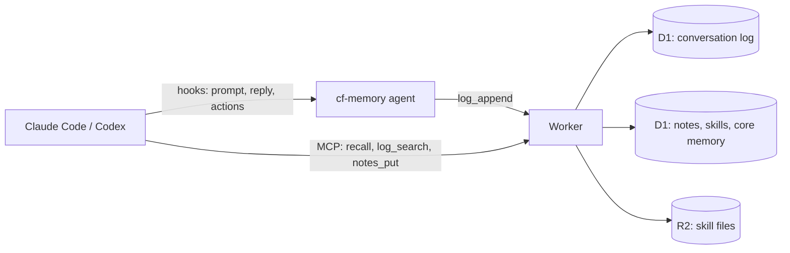

# cf-memory

Memory for your coding agents, in your own Cloudflare account. Every prompt and
final reply is kept word for word and found again by keyword. No vector
database, no model calls.

[日本語](README.ja.md)

Claude Code and Codex forget what you worked out yesterday. cf-memory is a
Cloudflare Worker plus a small hook plugin: the hooks record each turn, and at
the start of every prompt they put the related notes and past conversations
back in front of the agent.

cf-memory is an independent project. It runs on Cloudflare and is not affiliated
with or endorsed by Cloudflare, Inc.

## Install

You need a Cloudflare account on the Workers Paid plan, Node.js 22 or newer,
and Claude Code or Codex.

```bash
git clone https://github.com/24taro/cf-memory.git
cd cf-memory
./install.sh
```

The script logs you in to Cloudflare, creates two D1 databases and an R2 bucket,
deploys the Worker, generates your API token, checks that the server answers,
and connects Claude Code and Codex if they are installed. Restart your agent
when it finishes.

Then ask your agent something you discussed in an earlier session, or run:

```bash
node cf-memory-agent/scripts/agent.mjs doctor
```

Run `./install.sh` again at any time to update. It keeps your data and token.

## How it works

1. **Record.** Hooks keep each prompt and the agent's final reply in full, plus
   one line per tool action and the head of failed output. Text is scrubbed for
   secrets on your machine before it is sent. Nothing is summarized.
2. **Recall.** On every prompt the hook searches your notes and skills by
   keyword and injects the matches. At session start it injects your core memory
   and the last reply of the previous session in the same repository.
3. **Search.** When the agent needs older context it searches the kept
   conversation itself (`log_search`, `log_read`) and saves what is worth
   keeping as a note (`notes_put`).



Search is keyword-only: SQLite FTS5 trigram indexes over notes and
conversations, with a substring fallback for one- and two-character queries.
It works for Japanese and English.

## Where your data lives

Everything is stored in D1 and R2 in your own Cloudflare account. The only
network destination is your Worker. The API token is in `.cf-memory.secrets` in
this checkout (mode 0600, ignored by git) and in your agent's MCP configuration.

Prompts and final replies are kept until you delete them. Tool-action lines and
error heads are deleted after 90 days (`LOG_ACTION_RETENTION_DAYS`).

## Cost

cf-memory is built for the Workers Paid plan. The Free plan allows 5 million D1
rows read per day, and one heavy day of the author's own use read about 8
million, so on the Free plan it can stop answering until the next day.

## Uninstall

```bash
node cf-memory-agent/scripts/agent.mjs uninstall
claude mcp remove cf-memory --scope user
npx wrangler delete
npx wrangler d1 delete cf-memory
npx wrangler d1 delete cf-memory-logs
npx wrangler r2 bucket delete cf-memory-bundles
```

## More

- [Web pages behind Cloudflare Access](docs/WEB-ACCESS.md): read and edit your notes in a browser.
- [Team mode](docs/TEAM-MODE.md): several people on one instance, with an OAuth authorization server.
- [The agent plugin](cf-memory-agent/README.md): what each hook does, the local spool, settings.
- [Security](SECURITY.md): the trust model and how to report a problem.

## Develop

```bash
npm ci
npm run typecheck
npm test -- --maxWorkers=1
npm run dev
```

## License

[MIT](LICENSE)
