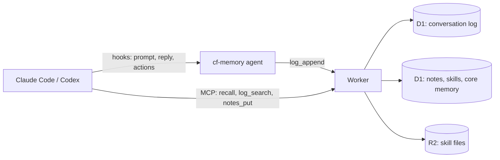

# cf-memory

[](https://github.com/24taro/cf-memory/actions/workflows/ci.yml) · [MIT License](LICENSE)

**Give Claude Code and Codex a memory that lives in your Cloudflare account.**
Resume a repository in a new session with yesterday's decisions, search the
conversation that justified them, and keep the useful parts as notes.

[Quick start](#quick-start) · [How it works](#how-it-works) · [Data and retention](#where-your-data-lives) · [日本語](README.ja.md)

| When you… | cf-memory… |
| --- | --- |
| Open a new session in a repository | Brings in your core memory and the previous session's last reply. |
| Ask about a past decision | Recalls related notes, and lets your agent search the stored conversation by keyword. |
| Switch between Claude Code and Codex | Gives both clients the same notes and conversation history when they connect to the same instance. |

One Worker, two D1 databases, and an R2 bucket. Search uses SQLite FTS5, works
in Japanese and English, and makes zero embedding or model calls. cf-memory
is an independent, MIT-licensed project.

The initial release supports one owner per instance using a fixed API token.
[Team mode](docs/TEAM-MODE.md) is experimental.

## Quick start

**Requirements.** Cloudflare Workers Paid with R2 enabled, Git, Bash,
Node.js 22.12+ (22.x) or 24+ with npm, OpenSSL, and curl. Use Claude Code
2.1.327 or later, or Codex. Update an older Claude Code installation first.

```bash
git clone https://github.com/24taro/cf-memory.git
cd cf-memory
./install.sh
```

Approve the Cloudflare login when prompted. The installer provisions the
storage, deploys the Worker, saves the API token, and connects the clients
it finds. Use `./install.sh --no-client` for the Worker alone.

- **Claude Code.** Restart it after installation.
- **Codex.** Load the two printed `export` lines in your shell before
  launching Codex. Run `/hooks` and approve the four cf-memory hooks.

### Try a handoff

Open Claude Code or Codex in a Git repository and use these two prompts in
separate sessions.

| Session | Prompt |
| --- | --- |
| First | Our smoke test is called Blue Lantern. Repeat that name in your final reply. |
| Next | What did we call our smoke test? |

Close the first session after its reply. Open the next one in the same
repository. The SessionStart hook brings in the previous reply, so the agent
can answer **Blue Lantern** from that context. Both clients can use the same
handoff when they connect to the same instance.

If the new session misses the fact, check the hooks and connection from the
cf-memory checkout.

```bash
node cf-memory-agent/scripts/agent.mjs doctor
```

For older conversations, ask the agent to search the log by keyword, such as
`log_search` for `Blue Lantern`. Save a decision as a note when you want it to
surface in future keyword Recall.

### Update or resume setup

To update, pull the latest changes in the same checkout and run `./install.sh`
again. Keep `.cf-memory.secrets` and `.cf-memory.deployment.json`. They identify
the token, Worker, two D1 database IDs, and the R2 bucket's name, jurisdiction,
and creation time. The installer verifies storage before updating the Worker
and again before running migrations.
If you move to another checkout, copy both files and select the original
Cloudflare account. Update the registered Claude Code marketplace to the new
checkout before reconnecting Claude Code. See [Security](SECURITY.md) for token
rotation.

If the first install is interrupted, keep `.cf-memory.install-claim` and
any deployment and token files it created, then rerun from that checkout.
For an earlier setup with only `.cf-memory.secrets`, pass the original Worker
URL shown by your prior installer. The installer records the deployment
identity after it matches that URL and verifies your token.

```bash
./install.sh --existing-url https://cf-memory.your-subdomain.workers.dev
```

The installer reports MCP and hook status separately for each client.
If Codex prompts again after an update, review the hooks in `/hooks`.

## How it works

1. **Record.** Hooks keep prompt and reply text within per-entry size limits,
   plus one line per tool action and an excerpt of failed output. Text is
   scrubbed locally for common secret formats before it is sent.
2. **Recall.** On every prompt the hook searches your notes and skills by
   keyword and injects relevant matches. At session start it injects your core memory
   and the last reply of the previous session in the same repository.
3. **Search.** When the agent needs older context it searches the kept
   conversation itself (`log_search`, `log_read`) and saves what is worth
   keeping as a note (`notes_put`).



Search is keyword-only: SQLite FTS5 trigram indexes over notes and
conversations, with a substring fallback for one- and two-character queries.
It works for Japanese and English.

## Where your data lives

The hooks send conversation data to your Worker. Your Cloudflare account stores
it in D1, and skill attachments live in R2. The browser UI loads Google Fonts
and may request external images embedded in notes. The installer stores the API
token in `.cf-memory.secrets` in this checkout (mode 0600, ignored by Git).

### Delete conversation logs

Prompts and final replies have no automatic expiry. Daily maintenance removes
tool-action lines and error excerpts older than `LOG_ACTION_RETENTION_DAYS`
(90 days by default). Individual log entries are managed in D1.

The separate Capture API stores short-lived source events when a client
explicitly sends them. The default retention is seven days from receipt.
Expired events are excluded from reads immediately and removed by daily
maintenance. Saved provenance can outlive its source event.

1. Close the connected clients while you clean up. Review their local queue at
   `~/.cf-memory/v3/spool/` (or `$CF_MEMORY_AGENT_HOME/spool/`). If you want to
   discard every queued, held, and rejected entry for both clients in that
   profile, delete the `spool` directory before restarting either client.
   Entries still queued locally can be uploaded again. Set
   `CF_MEMORY_LOG_ENABLED=false` to turn off recording and sending.
2. Find the entry ID with `log_search`. In Cloudflare, open the D1 console of
   the database bound as `LOGS` (`cf-memory-logs` by default). Run the `SELECT`
   first, then replace `123` with the row ID you verified. The database trigger
   removes the deleted row from the search index.

   ```sql
   SELECT rowid, user_id, client, kind FROM log_entries WHERE id = '<entry-id>';
   DELETE FROM log_entries WHERE rowid = 123 AND id = '<entry-id>';
   ```

   This removes the entry from the active database. Copies may still exist in
   [D1 Time Travel](https://developers.cloudflare.com/d1/reference/time-travel/),
   backups, or notes you saved separately.

## Cost

Use the Workers Paid plan. Requests, D1 rows read and written, and R2 storage
and operations depend on your usage. Cloudflare publishes the included usage
and additional charges for each service.
[Workers pricing](https://developers.cloudflare.com/workers/platform/pricing/) · [D1 pricing](https://developers.cloudflare.com/d1/platform/pricing/) · [R2 pricing](https://developers.cloudflare.com/r2/pricing/)

## Uninstall

To disconnect your agent, run the commands for the client you installed:

```bash
node cf-memory-agent/scripts/agent.mjs uninstall --client claude-code
claude mcp remove cf-memory --scope user

node cf-memory-agent/scripts/agent.mjs uninstall --client codex
codex mcp remove cf-memory
```

For Codex, also remove the `CF_MEMORY_MCP_URL` and `CF_MEMORY_ACCESS_TOKEN`
export lines from your shell profile and open a new shell. The uninstaller
keeps the local spool and diagnostics in `~/.cf-memory/v3`.

To remove the hosted instance, open its original account in Cloudflare and
match the Worker name and account against `.cf-memory.deployment.json` before
deleting it. To also remove its data, match both D1 database IDs and the R2
bucket in that file. Delete the databases and empty and delete the bucket.
Remove any associated Cloudflare Access or custom-domain configuration that
you created for the instance. Delete `.cf-memory.secrets` and
`.cf-memory.deployment.json` from the checkout when you finish.

## More

- [Web pages behind Cloudflare Access](docs/WEB-ACCESS.md): read and edit your notes in a browser.
- [Experimental team mode](docs/TEAM-MODE.md): several people on one instance, with an OAuth authorization server.
- [The agent plugin](cf-memory-agent/README.md): what each hook does, the local spool, settings.
- [Security](SECURITY.md): the trust model and how to report a problem.

## Develop

Initialize both local D1 databases and create a development-only token before
starting Wrangler:

```bash
npm ci
npm run db:apply:local
npm run db:logs:apply:local
if [ ! -e .dev.vars ]; then
  (umask 077; printf 'API_TOKEN=%s\n' "$(openssl rand -hex 32)" > .dev.vars)
fi
npm run dev
```

In another terminal, check the local instance without changing any saved client
settings:

```bash
sed -n 's/^API_TOKEN=/Authorization: Bearer /p' .dev.vars |
  curl -fsS -H @- http://localhost:8787/api/v1/whoami
```

Run the checks with:

```bash
npm run typecheck
npm test -- --maxWorkers=1
```

## License

[MIT](LICENSE)
