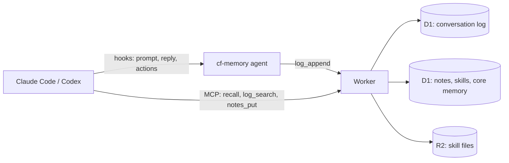

# cf-memory

Memory for your coding agents, in your own Cloudflare account. Every prompt and
final reply is kept word for word and found again by keyword. No vector
database, no model calls.

[日本語](README.ja.md)

Claude Code and Codex forget what you worked out yesterday. cf-memory is a
Cloudflare Worker plus a small hook plugin: the hooks record each turn, and at
the start of every prompt they put the related notes and past conversations
back in front of the agent.

cf-memory is an independent project. It runs on Cloudflare and is not affiliated
with or endorsed by Cloudflare, Inc.

The initial release supports one owner per instance using a fixed API token.
[Team mode](docs/TEAM-MODE.md) is experimental.

## Install

You need a Cloudflare account on the Workers Paid plan with R2 enabled, Git,
Bash, Node.js 22.12+ (22.x) or 24+ with npm, OpenSSL, and curl. To connect an
agent, install Claude Code 2.1.327 or later, or Codex. If an older Claude Code
version is installed, update it before running the installer. The installer
checks the Claude Code version before deploying or changing any client settings.
Run `./install.sh --no-client` to deploy the Worker on its own.

```bash
git clone https://github.com/24taro/cf-memory.git
cd cf-memory
./install.sh
```

The script logs you in to Cloudflare, creates two D1 databases and an R2 bucket,
deploys the Worker, generates your API token, checks that the server answers,
and connects Claude Code and Codex if they are installed.
It reports MCP registration and hook installation separately. If either step
fails for one client, setup still runs for the other client and the script exits
with an error.

The first install reserves the Worker name in your Cloudflare account. If it
is interrupted, rerun it from the same checkout and keep
`.cf-memory.install-claim` and `.cf-memory.secrets` if present. The installer
removes the claim file once it verifies the connection.

If you use Codex, add the two export lines printed by the installer to your
shell profile and load it before launching Codex. Open `/hooks` and approve
the four cf-memory hooks. If Codex asks again after an update, review and
approve the new hooks there.

To verify recording and recall, tell your agent a test fact and ask it to
repeat the fact in its final reply. Start a new session in the same Git
repository and ask for that fact. To check the connection and hook status, run:

```bash
node cf-memory-agent/scripts/agent.mjs doctor
```

To update, pull the latest changes in the same checkout and run `./install.sh`
again. Use the same Cloudflare account and keep `.cf-memory.secrets` to reuse
the API token. The databases and bucket are reused.
Regular updates preserve the deployed token. If you move to another checkout,
copy the original `.cf-memory.secrets` before installing. See [Security](SECURITY.md)
for token rotation.

## How it works

1. **Record.** Hooks keep each prompt and the agent's final reply in full, plus
   one line per tool action and the head of failed output. Text is scrubbed for
   secrets on your machine before it is sent. Nothing is summarized.
2. **Recall.** On every prompt the hook searches your notes and skills by
   keyword and injects the matches. At session start it injects your core memory
   and the last reply of the previous session in the same repository.
3. **Search.** When the agent needs older context it searches the kept
   conversation itself (`log_search`, `log_read`) and saves what is worth
   keeping as a note (`notes_put`).



Search is keyword-only: SQLite FTS5 trigram indexes over notes and
conversations, with a substring fallback for one- and two-character queries.
It works for Japanese and English.

## Where your data lives

The hooks send conversation data to your Worker. Your Cloudflare account stores
it in D1, and skill attachments live in R2. The browser UI loads Google Fonts
and may request external images embedded in notes. The installer stores the API
token in `.cf-memory.secrets` in this checkout (mode 0600, ignored by Git).

### Delete conversation logs

Prompts and final replies have no automatic expiry. Daily maintenance removes
tool-action lines and error excerpts older than `LOG_ACTION_RETENTION_DAYS`
(90 days by default). Individual log entries are managed in D1.

1. Close the connected clients while you clean up. Review their local queue at
   `~/.cf-memory/v3/spool/` (or `$CF_MEMORY_AGENT_HOME/spool/`). If you want to
   discard every queued, held, and rejected entry for both clients in that
   profile, delete the `spool` directory before restarting either client.
   Entries still queued locally can be uploaded again. Set
   `CF_MEMORY_LOG_ENABLED=false` to turn off recording and sending.
2. Find the entry ID with `log_search`. In Cloudflare, open the D1 console of
   the database bound as `LOGS` (`cf-memory-logs` by default). Run the `SELECT`
   first, then replace `123` with the row ID you verified. The database trigger
   removes the deleted row from the search index.

   ```sql
   SELECT rowid, user_id, client, kind FROM log_entries WHERE id = '<entry-id>';
   DELETE FROM log_entries WHERE rowid = 123 AND id = '<entry-id>';
   ```

   This removes the entry from the active database. Copies may still exist in
   [D1 Time Travel](https://developers.cloudflare.com/d1/reference/time-travel/),
   backups, or notes you saved separately.

## Cost

cf-memory is built for the Workers Paid plan. The Free plan allows 5 million D1
rows read per day, and one heavy day of the author's own use read about 8
million, so on the Free plan it can stop answering until the next day.

## Uninstall

To disconnect your agent, run the commands for the client you installed:

```bash
node cf-memory-agent/scripts/agent.mjs uninstall --client claude-code
claude mcp remove cf-memory --scope user

node cf-memory-agent/scripts/agent.mjs uninstall --client codex
codex mcp remove cf-memory
```

For Codex, also remove the `CF_MEMORY_MCP_URL` and `CF_MEMORY_ACCESS_TOKEN`
export lines from your shell profile and open a new shell. The uninstaller
keeps the local spool and diagnostics in `~/.cf-memory/v3`.

To permanently remove the hosted instance and its data, select its Cloudflare
account and run:

```bash
npx wrangler delete
npx wrangler d1 delete cf-memory
npx wrangler d1 delete cf-memory-logs
npx wrangler r2 bucket delete cf-memory-bundles
```

Empty the R2 bucket first if it contains objects. If you set up Cloudflare
Access or a custom domain, remove the associated settings in Cloudflare. Once
you no longer need the API token, delete `.cf-memory.secrets` from the checkout.

## More

- [Web pages behind Cloudflare Access](docs/WEB-ACCESS.md): read and edit your notes in a browser.
- [Experimental team mode](docs/TEAM-MODE.md): several people on one instance, with an OAuth authorization server.
- [The agent plugin](cf-memory-agent/README.md): what each hook does, the local spool, settings.
- [Security](SECURITY.md): the trust model and how to report a problem.

## Develop

Initialize both local D1 databases and create a development-only token before
starting Wrangler:

```bash
npm ci
npm run db:apply:local
npm run db:logs:apply:local
if [ ! -e .dev.vars ]; then
  (umask 077; printf 'API_TOKEN=%s\n' "$(openssl rand -hex 32)" > .dev.vars)
fi
npm run dev
```

In another terminal, check the local instance without changing any saved client
settings:

```bash
sed -n 's/^API_TOKEN=/Authorization: Bearer /p' .dev.vars |
  curl -fsS -H @- http://localhost:8787/api/v1/whoami
```

Run the checks with:

```bash
npm run typecheck
npm test -- --maxWorkers=1
```

## License

[MIT](LICENSE)
